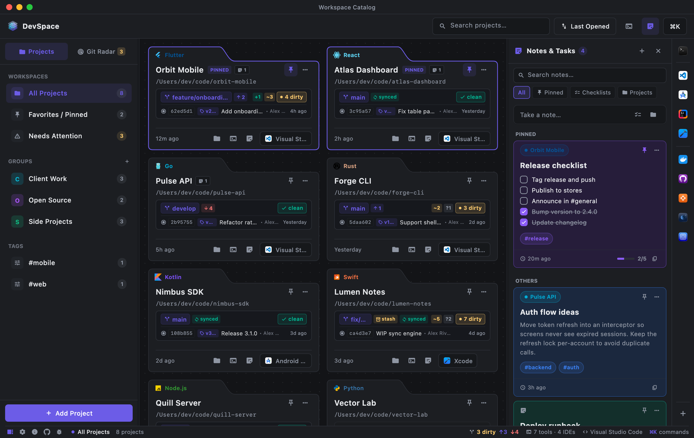
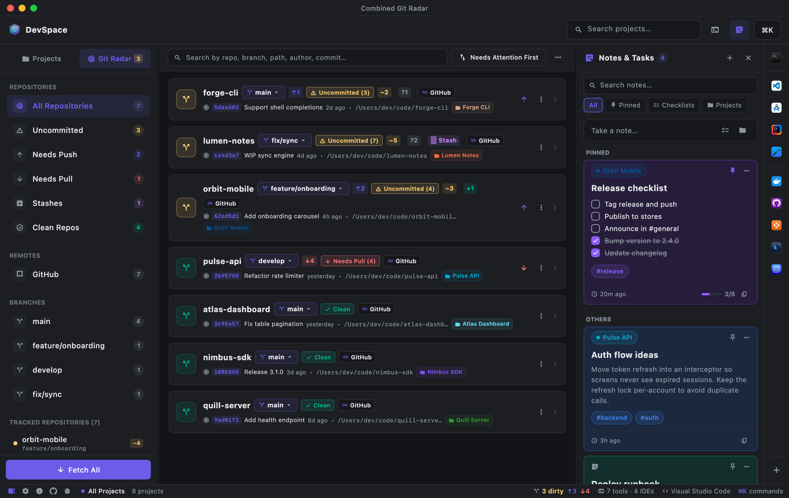
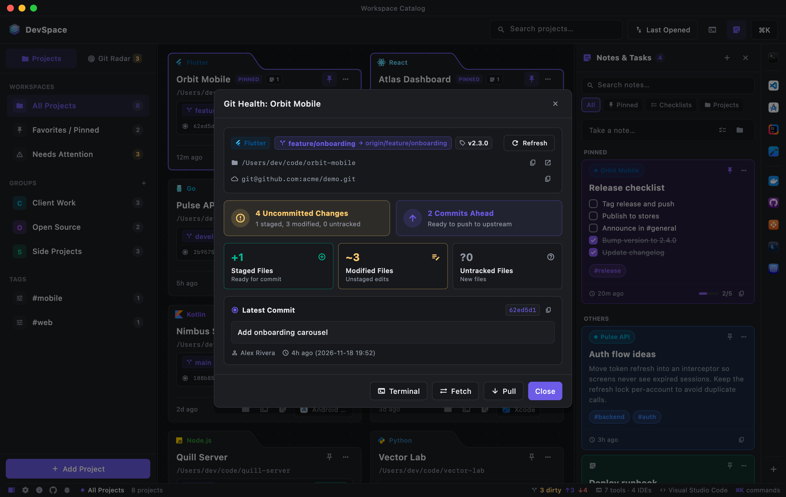
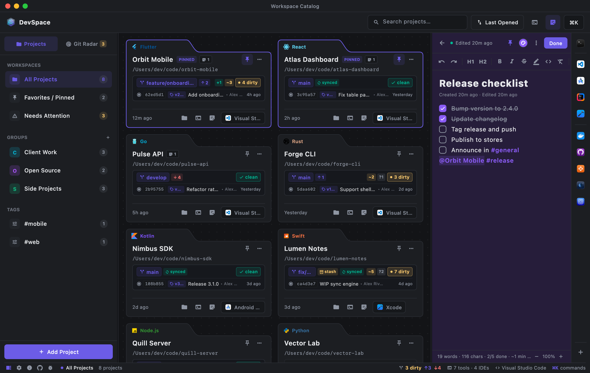
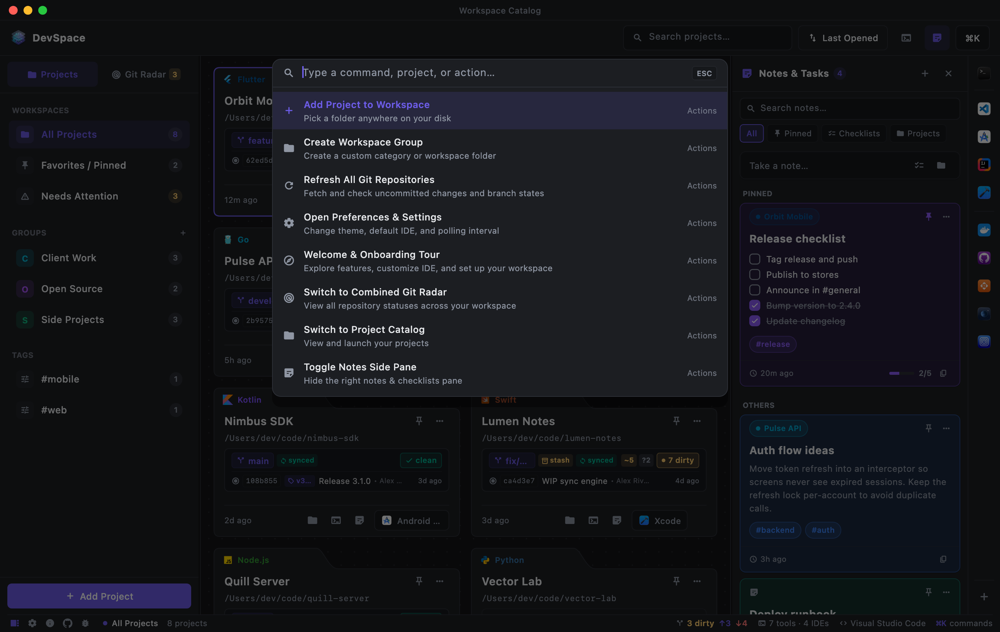
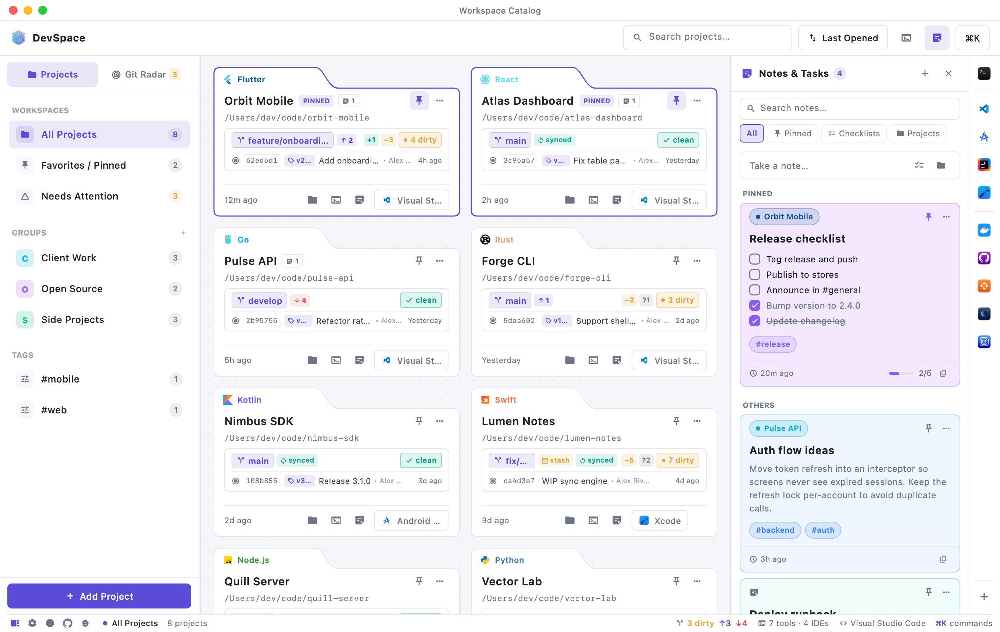
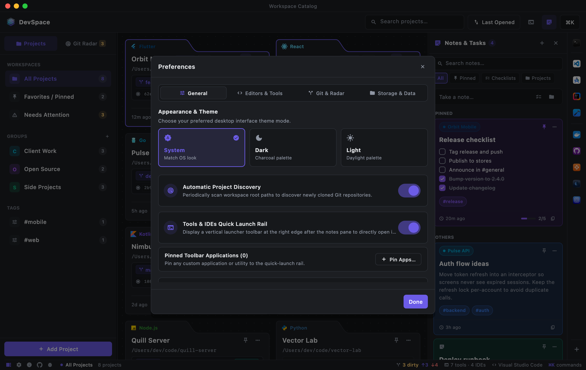

<h1 align="center">DevSpace</h1>

  A unified, keyboard-first desktop command center for developers. 
  Organize local projects, launch any IDE, track Git repositories, and manage scratchpad checklists — without friction. 
  Runs natively on macOS, Windows, and Linux.

  <strong>Native Desktop</strong> • <strong>Zero Cloud Lock-in</strong> • <strong>Offline First</strong> • <strong>Sub-100ms Startup</strong>

  

---

## App Details

| Property | Details |
|---|---|
| **Platforms** | macOS 12+ (Universal: Apple Silicon & Intel), Windows 10/11 (x64), Linux (x86_64) |
| **Technology** | Pure native desktop application (zero Electron overhead, instant sub-100ms startup) |
| **Data & Privacy** | 100% offline, local-first storage (no external accounts, no cloud sync, zero telemetry) |
| **Application ID** | `dev.prateekthakur.devspace` |

---

## Why DevSpace

- **Your projects stay where they belong.** No forced folder structures, no moving files, and no cloud dependencies. Register projects wherever they live on your disk.
- **Smart IDE and editor launcher.** Automatically detects installed editors (VS Code, Cursor, Android Studio, IntelliJ IDEA, Xcode, Zed, terminal editors). Set per-project preferences and launch monorepo subprojects or canonical roots effortlessly.
- **Repository-First Git Radar.** Consolidates all your Git repositories into a single responsive view. Monitor dirty files, ahead/behind sync states, branches, and stashes across your entire system at a glance.
- **Interactive Git sidepane.** Inspect inline syntax-highlighted diffs, stage or unstage changes, discard modifications, switch branches, and record commits directly from the app.
- **Project scratchpad with live checklists.** Keep meeting notes, snippet references, and interactive checklists (`[]`) associated directly with your projects.
- **Fast, local, and keyboard-first.** Command palette (`⌘K` / `Ctrl+K`), trackpad-safe desktop splitters, zero-cloud storage, and instant sub-100ms cold startup.

---

## Core Features: A Brief Overview

### 1. Unified Project Catalog & Workspaces
Track projects across multiple hard drives and directories without moving them:
- **Drag & Drop Import**: Drag any project folder or repository directly from Finder or File Explorer into DevSpace to import it instantly, or drop onto a specific group in the sidebar.
- **Instant Recognition**: Auto-detects project ecosystems including Flutter, Node.js, Python, Rust, Go, Java, Docker, Ruby, Swift, and C++.
- **Workspaces & Tags**: Group related projects into custom workspaces (e.g., *Client Work*, *Open Source*, *Personal Experiments*) with color-coded tags.
- **Favorites & Pinning**: Pin your active projects to anchor them at the very top of your dashboard.
- **Custom Scripts**: Register build, test, and dev runner commands that execute directly from the project detail card.

### 2. Multi-IDE & Monorepo Launcher
Eliminate the friction of opening the wrong editor or navigating nested directories:
- **Automatic IDE Discovery**: DevSpace scans system paths to detect installed editors (VS Code, Cursor, Android Studio, IntelliJ IDEA, Xcode, Zed, Fleet, and terminal-based editors).
- **Per-Project Default Preferences**: Assign your preferred IDE to each project (e.g., Xcode for Swift/iOS, Android Studio for Android, VS Code for web services).
- **Monorepo-Aware Submenus**: When a Git repository hosts multiple subprojects, DevSpace provides an intuitive **Open** submenu allowing you to launch specific subprojects or the canonical **Repo Root** in your default editor.
- **Custom Launch Arguments**: Add custom IDE binaries or launch flags directly in settings.

### 3. Repository-First Git Radar
Keep pulse on your entire code machine without running `git status` in a dozen terminal windows:
- **Monorepo Aggregation**: Groups projects sharing a Git root under a single canonical repository card.
- **Live Sync Badges**: Color-coded indicators highlight uncommitted modifications (`dirty`), commits needing push (`ahead`), upstream updates waiting (`behind`), and active stashes.
- **Single-Row Compact Header**: Features instant search across repository names, branches, paths, and commit authors, accompanied by multi-criteria sorting (Needs Attention First, Name, Path, Unpushed, Uncommitted).
- **One-Click Batch Actions**: Trigger `Fetch All`, `Pull Clean`, `Push All`, or `Stash All Dirty` across all monitored repositories simultaneously.

### 4. Interactive Git Sidepane & Diff Viewer
Perform everyday Git operations without switching to a bulky standalone Git client:
- **Diff Inspection**: Click any repository to open the sidepane and review syntax-highlighted side-by-side or unified diffs for modified files.
- **Selective Staging**: Stage, unstage, or discard changes on a per-file basis.
- **Branch Management**: Switch between local and remote branches or create new branches on the fly.
- **Direct Commits**: Enter your commit message and commit directly from DevSpace.

### 5. Scratchpad & Interactive Task Checklists
Jot down ephemeral thoughts, architecture ideas, or task lists alongside your code:
- **Project Association**: Attach notes directly to a project or maintain unlinked global scratchpads.
- **Live Checklists**: Type `[] ` to instantly create interactive checkboxes that toggle and persist state in local markdown files.
- **Full-Text Search**: Quickly filter through notes and snippet archives.

### 6. Developer Tools & CLI Scanner
Inspect your machine's developer environment health:
- Automatically detects installed CLI tools, runtimes, package managers, and container engines (Docker, Node, Flutter, Rust, Python, Go, Homebrew).
- Reports installed version numbers and executable paths.

### 7. Universal Command Palette (`⌘K` / `Ctrl+K`)
Navigate DevSpace at the speed of thought:
- Fuzzy-search projects, run Git batch commands, switch tabs, toggle workspaces, or open settings without touching the mouse.

---

## Features at a glance

| Area | Capabilities |
|---|---|
| **Project Catalog** | Register projects from anywhere on your filesystem; automatic detection of frameworks and ecosystems (Flutter, Node, Python, Rust, Go, Java, Docker, C++, Swift); project pinning, custom color tags, and workspace categorization. |
| **Flexible IDE Launcher** | Auto-discovers installed editors (VS Code, Cursor, Android Studio, IntelliJ IDEA, Xcode, Zed, Fleet, terminal editors); customizable default editor per project; multi-project monorepo submenus; custom binary path and launch argument support. |
| **Repository-First Git Radar** | Monorepo-aware repository grouping; live status badges for uncommitted (`dirty`), unpushed (`ahead`), unpulled (`behind`), and stashed changes; single-row compact toolbar with integrated instant search, multi-field sorting, and active filter dismissal. |
| **Interactive Git Sidepane** | Inspect unstaged and staged files; inline split and unified diff view; single-click file staging and unstaging; file discard; branch selector and creator; direct commit with commit message input; remote fetch, pull, and push. |
| **Batch Operations** | Single-click `Fetch All`, `Pull Clean`, `Push All`, and `Stash All Dirty` across all registered repositories. |
| **Scratchpad & Checklists** | Project-specific notes and global scratchpads; interactive checklist formatting with `[]` syntax; search and real-time state persistence. |
| **Developer Tools & SDKs** | Automated detection of installed developer CLIs, SDK runtimes, package managers, and container tools (Docker, Node, Flutter, Rust, Python, Go, Homebrew) with version reporting. |
| **Universal Command Palette** | `⌘K` (macOS) / `Ctrl+K` (Windows/Linux) instant launcher: fuzzy search across projects, Git batch actions, navigation tabs, and system preferences. |
| **Desktop Polish** | Frameless window with native macOS traffic lights (`leftInset: 72`); custom title bar with window controls on Windows/Linux; trackpad drag separation (`kDragDevices`); shrink-wrapped desktop modal dialogs (`ModalScaffold`); window position restoration. |

## Screenshots

| | |
|---|---|
|  |  |
| **Git Radar** with single-row responsive header | **Interactive Git Sidepane** with diffs & staging |
|  |  |
| **Scratchpad & Notes** with interactive checklists | **Universal Command Palette** (`⌘K` / `Ctrl+K`) |
|  |  |
| **Light Theme** | **Preferences** and editor configuration |

## Install

Download the installer for your platform from the [latest release](../../releases/latest):

| System | Files | How |
|---|---|---|
| **macOS** (Apple silicon and Intel) | `.dmg`, `.pkg` | Open the DMG and drag **DevSpace** to Applications |
| **Windows** | `.exe` (setup), `.msix` | Run the setup program |
| **Linux** | `.deb`, `.rpm`, `.AppImage` | `sudo apt install ./<file>.deb`, `sudo dnf install ./<file>.rpm`, or `chmod +x` the AppImage and run it |

The installers are currently unsigned. On macOS, right-click the app and choose **Open** the first time; Windows may show a SmartScreen warning.

## Documentation

| Guide | What it covers |
|---|---|
| [User manual](docs/user-manual.md) | Step-by-step help for everyday workflows |
| [Getting started](docs/getting-started.md) | First run walkthrough and adding your first project |
| [Features](docs/features.md) | In-depth tour of capabilities and tools |
| [Keyboard shortcuts](docs/keyboard-shortcuts.md) | Keyboard shortcuts cheat sheet and command palette |
| [Troubleshooting](docs/troubleshooting.md) | Common issues, editor detection, and diagnostics |
| [Architecture](docs/ARCHITECTURE.md) | System architecture and design invariants |
| [Engineering guidelines](docs/guidelines.md) | Desktop design system and guidelines |
| [Building and releasing](docs/building-and-releasing.md) | Packaging desktop installers for macOS, Windows, and Linux |
| [Contributing](docs/contributing.md) | Development setup and contribution guidelines |
