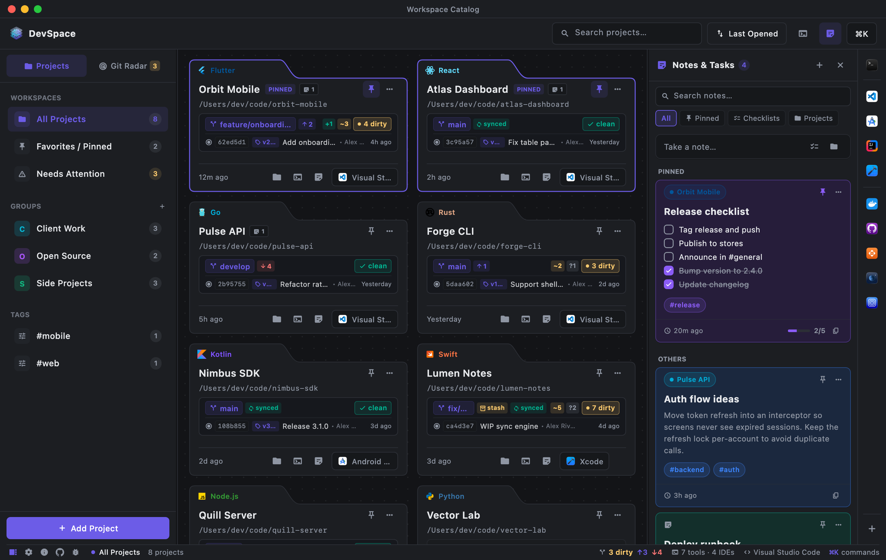
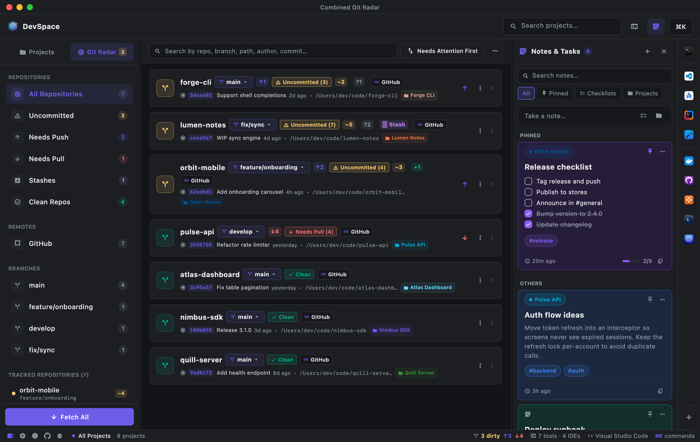
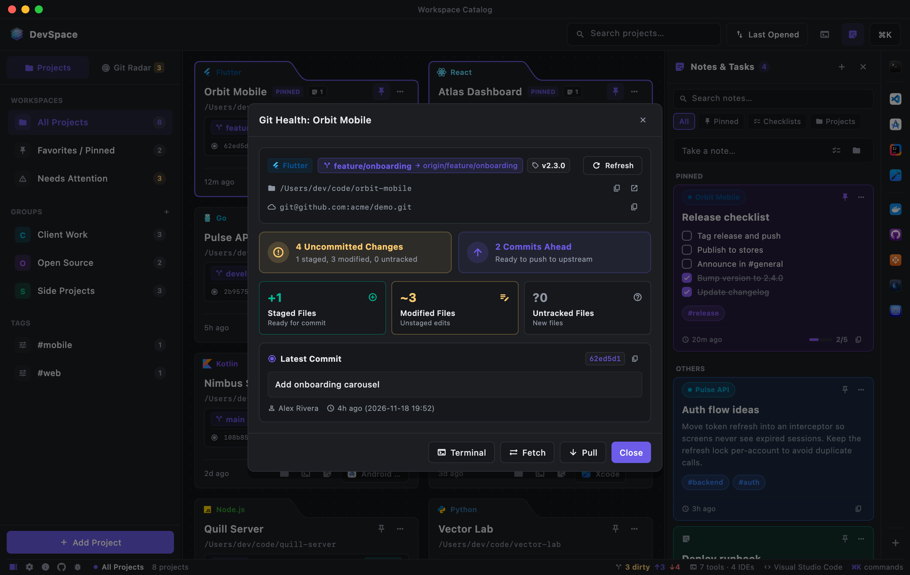
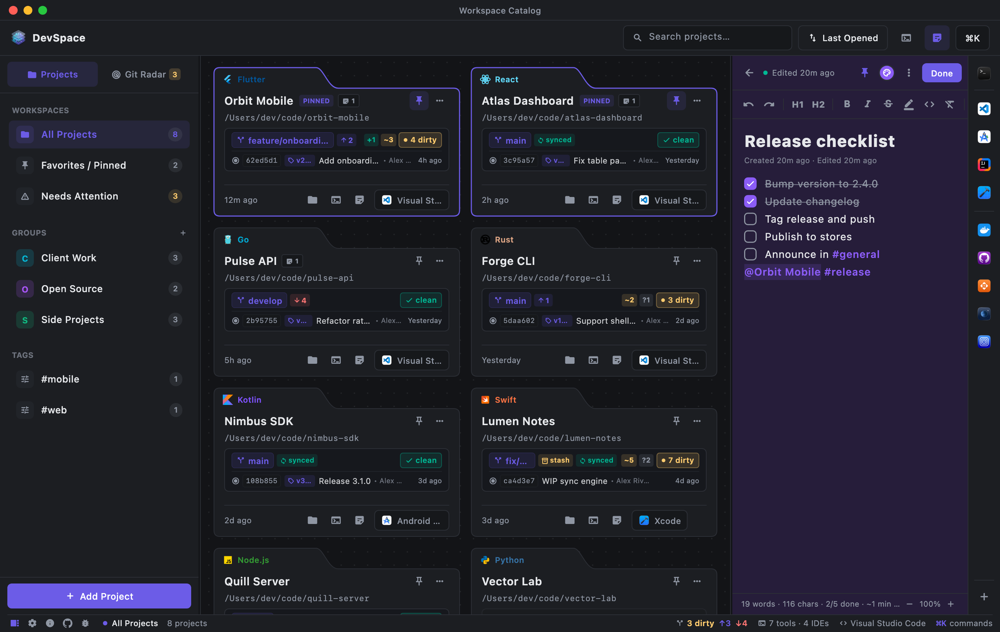
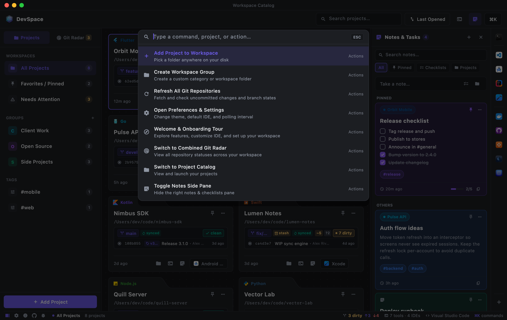
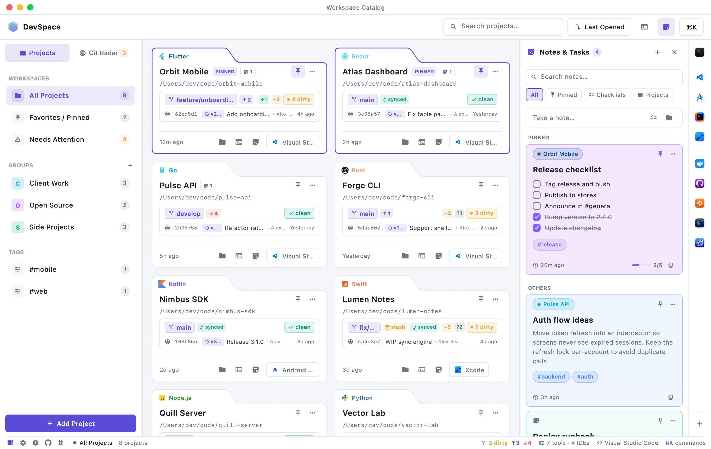
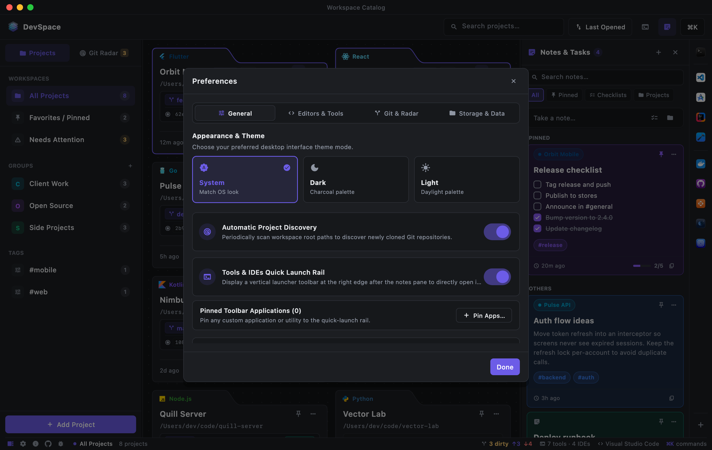

# Features

DevSpace provides an integrated, keyboard-friendly command center for developers.

## 1. Unified Project Catalog

- **Desktop Drag & Drop**: Drag any project folder or repository from Finder / File Explorer into the window to add it instantly, with support for batch folder imports and dropping onto specific sidebar groups.
- **Zero Project Relocation**: Register projects from anywhere on your filesystem without altering folder structures or symlinking.
- **Smart Ecosystem Detection**: Automatically recognizes project frameworks and tech stacks (Flutter, Node.js, Python, Rust, Go, Java, Docker, Ruby, Swift, C++, PHP).
- **Pinning & Favorites**: Pin your high-priority daily projects to the top of the catalog.
- **Project Groups & Workspaces**: Organize projects into custom categories with color-coded identifiers.
- **Project Detail View**: View repository details, registered build/dev scripts, linked notes, and quick action buttons.

## 2. Flexible IDE & Tool Launcher

- **Installed Editor Auto-Discovery**: Automatically discovers system installations of VS Code, Cursor, Android Studio, IntelliJ IDEA, Xcode, Zed, Fleet, and terminal editors.
- **Per-Project Default Preference**: Configure each project to open in its optimal editor (e.g., Xcode for iOS, Android Studio for Android/Kotlin, VS Code for web services).
- **Multi-Project & Monorepo Support**: When a Git repository hosts multiple subprojects, DevSpace provides intuitive submenus to open specific subprojects or the monorepo root in your default editor.
- **Custom IDE Paths**: Register custom editor binaries or pass specialized launch arguments.

## 3. Repository-First Git Radar

- **Consolidated Dashboard**: Monitor all your repositories in one live view without running manual `git status` commands across multiple directories.
- **Monorepo Aggregation**: Groups projects sharing a Git root into a single unified repository card.
- **Live Sync Indicators**: Color-coded badges for:
  - **Uncommitted Changes** (`dirty` count: modified, untracked, deleted files).
  - **Needs Push** (`ahead` count).
  - **Needs Pull** (`behind` count).
  - **Stashes** (active stash count).
- **Single-Row Compact Toolbar**: Responsive header with integrated instant search, multi-level sorting (Needs Attention First, Repository Name, Path, Unpushed, Uncommitted), and active filter dismissal.
- **Batch Git Operations**:
  - `Fetch All`: Background fetch across all registered repositories.
  - `Pull Clean`: Fast-forward pull clean repositories with remote updates.
  - `Push All`: Push commits for all repositories currently ahead.
  - `Stash All Dirty`: Quickly stash modifications across dirty repositories.

## 4. Interactive Git Sidepane

- **Inspect Unstaged & Staged Changes**: Categorized view of modified, added, deleted, and untracked files.
- **Inline Diffs**: View syntax-highlighted side-by-side or unified diffs for any modified file.
- **Staging Controls**: Stage or unstage individual files with a single click.
- **Discard Modifications**: Revert accidental changes or delete untracked scratch files safely.
- **Branch Management**: Switch between local and remote branches or create new branches on the fly.
- **Direct Commit**: Write commit messages and record commits directly from the sidepane.

## 5. Scratchpad & Task Checklists

- **Project-Linked Notes**: Attach notes and documentation directly to a project or maintain global scratchpads.
- **Interactive Checklists**: Type `[]` followed by a space to automatically generate interactive checkboxes that persist their state.
- **Fast Search & Filtering**: Locate code snippets, URLs, or task lists instantly.

## 6. Developer Tools & CLIs Dashboard

- **Automated Tool Scanner**: Scans for installed developer SDKs, runtimes, package managers, and container tools (Docker, Node, Flutter, Rust, Python, Go, Homebrew).
- **Version Detection**: Displays installed versions and environment health status.

## 7. Universal Command Palette (`⌘K` / `Ctrl+K`)

- **Instant Fuzzy Search**: Jump to any project, launch an editor, execute Git batch operations, switch workspaces, or open settings in milliseconds.
- **Keyboard-First Workflow**: Complete operations without lifting your hands from the keyboard.

## 8. Desktop Polish & Performance

- **Native macOS Title Bar**: Frameless aesthetic with preserved traffic lights (`leftInset: 72`).
- **Custom Windows/Linux Chrome**: Integrated title bar menus and platform-adaptive window controls.
- **Trackpad Safety**: All drag interactions use `kDragDevices` to prevent trackpad scrolling gestures from triggering unwanted layout resize actions.
- **Local Storage**: Synchronous, zero-cloud storage under `~/.devspace/` with sub-100ms startup times.

| | |
|---|---|
|  |  |
| **Light Theme** | **Preferences** |
