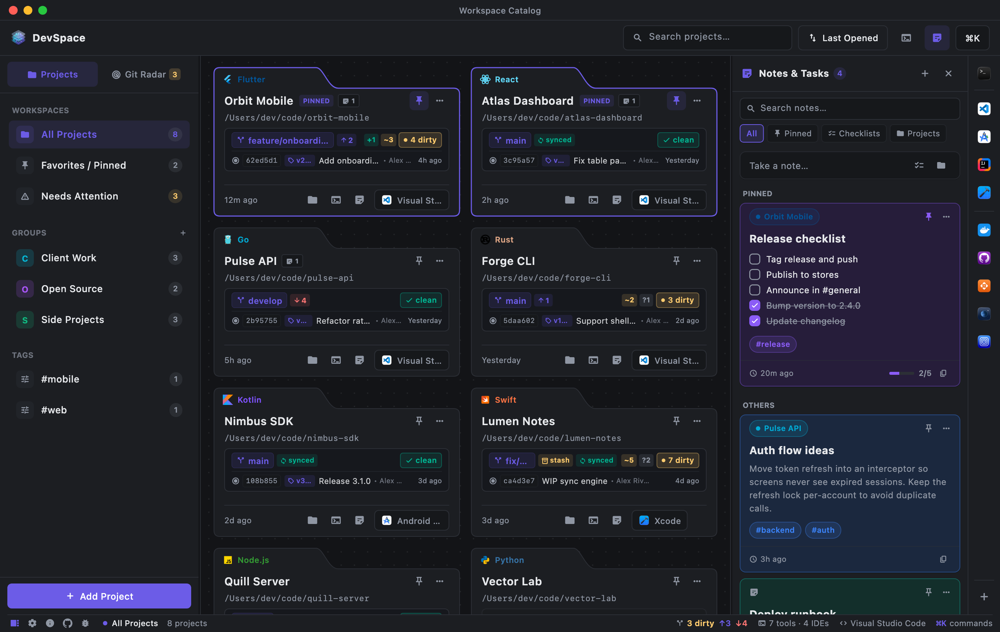

# Getting started

## Install

Download the installer for your system from the [latest release](../../../releases/latest).

| System | Files | How |
|---|---|---|
| **macOS** (Apple silicon and Intel) | `.dmg`, `.pkg` | Open the DMG and drag **DevSpace** to Applications |
| **Windows** | `.exe`, `.msix` | Run the setup program |
| **Linux** | `.deb`, `.rpm`, `.AppImage` | `sudo apt install ./<file>.deb`, `sudo dnf install ./<file>.rpm`, or make the AppImage executable and run it |

The installers are currently unsigned. On macOS, right-click the app and choose **Open** the first time; Windows may show a SmartScreen warning.

To build from source instead, see [building and releasing](building-and-releasing.md).

## First run

A short walkthrough appears the first time you launch DevSpace:
1. Detects installed IDEs, code editors, and developer CLI tools on your system.
2. Explains the core navigation tabs: **Projects**, **Git Radar**, **Notes**, and **Tools**.
3. Prompts you to add your first project directory or import an existing workspace.

Reopen the tour anytime from **Help ▸ Welcome Tour** or via the Command Palette (`⌘K` / `Ctrl+K`).

## Adding your first project

1. Click **+ Add Project** in the project catalog header, press **⌘N** (or **Ctrl+N** on Windows/Linux), or use the menu **Project ▸ Add Project**.
2. Choose a project folder on your machine. DevSpace automatically:
   - Detects the project name and ecosystem (Flutter, Node.js, Python, Rust, Go, Java, Docker, etc.).
   - Discovers any underlying Git repository, active branch, and sync state.
   - Detects all installed code editors (VS Code, Cursor, Android Studio, IntelliJ, Xcode, Zed, terminal editors).
3. Select your default editor preference for this project and click **Save**.

## Everyday workflows

- **Launch an editor**: Click the project's primary editor button or right-click to choose an alternate editor. If the repository contains multiple nested subprojects, an **Open** submenu allows opening individual subprojects or the repository root.
- **Inspect Git status**: Switch to the **Git Radar** tab (`⌘2`) to see all your repositories in one consolidated dashboard. Uncommitted changes, unpushed commits, and behind sync states are highlighted with color-coded status badges.
- **Inspect diffs & stage changes**: Click any repository in Git Radar to slide open the interactive **Git sidepane**. View file diffs, stage or discard specific modifications, switch branches, and write commit messages without leaving the app.
- **Quick scratchpad**: Switch to the **Notes** tab (`⌘3`) to jot down project tasks, checklists, or command snippets. Type `[]` followed by a space to automatically format interactive checklist items.
- **Command Palette**: Press **⌘K** (macOS) or **Ctrl+K** (Windows/Linux) anywhere to quickly search projects, switch tabs, launch tools, or trigger batch Git actions.

## Next steps

- Read the [user manual](user-manual.md) for full step-by-step guidance.
- Explore the [keyboard shortcuts](keyboard-shortcuts.md) to navigate at high speed.
- Learn about the [features](features.md) and [architecture](ARCHITECTURE.md).
