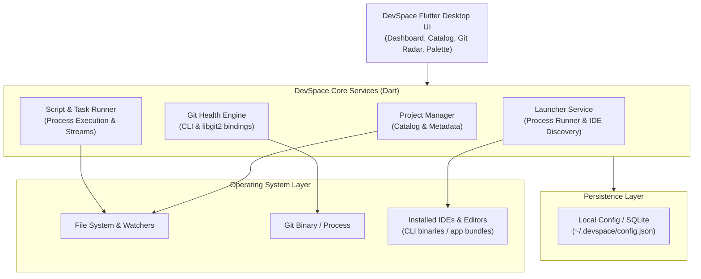

# DevSpace: Unified Developer Workspace

## 1. Executive Summary & Vision

**DevSpace** is a unified desktop command center designed for modern developers. It consolidates scattered repositories, frameworks, and developer tools into a single, cohesive desktop interface. 

Instead of juggling nested directories in file managers, managing multiple IDE windows, and manually checking terminal tabs for repository statuses, DevSpace allows developers to:
- **Organize & Aggregate**: Group and track projects regardless of where they reside on the filesystem.
- **Launch with Any Editor**: Open projects instantly in any editor (VS Code, Cursor, IntelliJ, Android Studio, Xcode, Zed, Neovim, etc.) with custom or per-project default IDE preferences.
- **Unified Git Status**: View the health, branches, uncommitted changes, and unpushed commits of all projects simultaneously.
- **Execute Quick Actions**: Run tasks, scripts, terminal sessions, and container environments without navigating directories.

---

## 2. Core Problem & Value Proposition

| Pain Point | How DevSpace Solves It |
| :--- | :--- |
| **Directory Scattering**<br>Projects live across various paths (`~/Projects`, `~/Work`, `/Volumes/ExternalDrive`, `~/go/src`). | **Virtual Workspace Mapping**: Index projects anywhere on disk without moving or symlinking files. Filter by workspace, client, stack, or tag. |
| **IDE Juggling & Mismatches**<br>Different projects require different IDEs (e.g. Flutter in Android Studio/VS Code, Rust in Zed, Python in PyCharm). | **Granular Editor Association**: Define per-project default editors, alternative editors, and custom CLI launch arguments with single-click/hotkey launching. |
| **Silent Git Drift**<br>Forgotten uncommitted changes, stashes, and unpushed commits lead to lost work and context switching. | **Combined Git Radar**: Real-time aggregated overview of branch status, uncommitted changes, unpushed/unpulled commits across all repos. |
| **Terminal Friction**<br>Constantly opening shells and `cd`-ing into paths to run dev scripts or checks. | **Embedded Quick Actions & Terminal Launch**: One-click integrated or external terminal launch directly into the root directory with predefined tasks. |

---

## 3. Key Feature Specifications

### 3.1. Unified Project Catalog
- **Location-Agnostic Project Registry**: Add projects via file picker, drag-and-drop, or auto-scanning directories (e.g., scanning `~/Development` for directories containing `.git`, `pubspec.yaml`, `package.json`, `Cargo.toml`, etc.).
- **Smart Tech Stack Detection**: Automatically inspects project root files and badges each project by framework and language:
  - Flutter / Dart (`pubspec.yaml`)
  - Node.js / React / Next.js (`package.json`)
  - Rust (`Cargo.toml`)
  - Go (`go.mod`)
  - Python (`pyproject.toml`, `requirements.txt`)
  - Java / Kotlin / Android (`build.gradle`, `pom.xml`)
  - iOS / macOS (`*.xcodeproj`, `Podfile`)
- **Metadata & Organization**:
  - Assign custom tags, workspaces (e.g. *Personal*, *Work*, *Open Source*), and favorites/pinned status.
  - Project notes and documentation quick links (e.g. Figma design links, Jira board, staging URLs).
  - Search and filter by name, technology stack, git branch, or tags.

### 3.2. Flexible IDE & Editor Launcher
- **Auto-Discovery of Installed Tools**: DevSpace scans the host operating system (macOS, Linux, Windows) to detect installed IDEs, code editors, and terminal emulators:
  - Visual Studio Code / Cursor / VSCodium
  - JetBrains Suite (IntelliJ IDEA, Android Studio, WebStorm, PyCharm, RustRover)
  - Apple Xcode
  - Zed, Sublime Text, Nova
  - Terminal-based editors (Neovim, Vim, Helix, Emacs) via preferred terminal emulator (Ghostty, iTerm2, Alacritty, Kitty, Windows Terminal)
- **Per-Project Default Preferences**:
  - Assign a default editor per project (e.g., open *Project A* in Android Studio, *Project B* in Cursor).
  - Primary button opens the default editor immediately (`Enter` or single click).
  - "Open with..." context menu and quick menu allows selecting any alternative installed editor on the fly.
  - Configurable launch flags and environment variables per project.

### 3.3. Combined Git Health & Status Monitor (Git Radar)
- **Repository-First Architecture (`RadarRepository`)**:
  - Automatically identifies git repository root paths and groups multiple DevSpace projects linked within the same repository (e.g. monorepos, microservices, multi-target packages).
  - Clean card representation: status emblems, branch switchers, uncommitted change chip breakdown (`~M +S ?U 📦`), and linked project tags with tech stack badges.
- **Detailed Inspection Sidepane**:
  - Selecting any repository opens an interactive, resizable right-hand detail pane with desktop drag splitters (`supportedDevices: kDragDevices`).
  - Five dedicated tabs:
    1. **Changes**: Live list of modified/staged/untracked files with inline unified diff viewer, per-file stage/unstage, discard changes, and quick commit box.
    2. **Commits**: Recent commit log with hash copying and author date.
    3. **Branches**: Local branch listing with one-click branch checkout and branch creation.
    4. **Projects**: Detailed view of all linked projects inside the repository with individual "Open" and "Terminal" triggers.
    5. **Git Tools**: Fast repository actions including *Fetch & Prune*, *Clean Untracked Files*, *Terminal at Repo Root*, and *Reveal in File Manager*.
- **Smart "Open" Context Submenus**:
  - Repositories containing multiple projects provide a nested "Open" submenu allowing developers to launch either individual projects in their designated IDEs or the entire repository root in their configured default editor.
- **Context-Aware Git Radar Left Sidebar**:
  - Dynamically activates when viewing Git Radar, replacing the project catalog tree with repository overview metrics (All, Uncommitted, Needs Push, Needs Pull, Stashes, Clean), remotes filter, active branches, and live repository status badges with full-width *Fetch All* footer.
- **Single-Row Responsive Toolbar**:
  - Search input, sort dropdown (*Needs Attention First*), active dismissible filter chips, batch action buttons (*Fetch All*, *Pull Clean*, *Push All*), and more actions menu consolidated into a single compact desktop row without redundant header titles.

### 3.4. Quick Actions, Scripts & Environment Management
- **Run Configurations & Scripts**:
  - Reads scripts from project manifests (e.g. `npm run`, `flutter run`, `cargo make`, `Makefile`).
  - Allows triggering scripts directly from DevSpace with output streaming in an integrated dock or floating panel.
- **Port & Service Tracking**:
  - Detect active dev servers bound to localhost ports linked to workspace projects.
- **Docker & Container Awareness**:
  - Detects `docker-compose.yml` and indicates whether the associated local containers are running, stopped, or degraded.

### 3.5. Universal Command Palette (`Cmd + K` / `Ctrl + K`)
- Fast keyboard-driven workflow:
  - Jump to any project by fuzzy search.
  - Switch branches or open specific files directly.
  - Change default editor or trigger quick actions without leaving the keyboard.

---

## 4. Architecture & Technical Design

DevSpace is built using **Flutter Desktop** targeting macOS, Linux, and Windows for native performance, low resource consumption, and uniform design language.



> For code patterns, window management, desktop-specific fixes, and implementation standards, see [Engineering Guidelines & Architecture](file:///Users/ent-0554/Documents/Prateeks%20Workspace/devspace/docs/guidelines.md).

### 4.1. Storage & Configuration Schema
DevSpace stores configuration in a portable, human-readable format located in the user directory (`~/.devspace/config.json`):

```json
{
  "version": "1.0.0",
  "settings": {
    "theme": "system",
    "defaultEditor": "vscode",
    "gitRefreshIntervalSeconds": 30,
    "terminalEmulator": "system"
  },
  "workspaces": [
    {
      "id": "ws-default",
      "name": "General",
      "color": "#6750A4"
    }
  ],
  "projects": [
    {
      "id": "proj-devspace-core",
      "name": "devspace",
      "path": "/Users/ent-0554/Documents/Prateeks Workspace/devspace",
      "workspaceId": "ws-default",
      "defaultEditor": "cursor",
      "tags": ["flutter", "desktop", "tooling"],
      "customScripts": [
        { "name": "Run macOS", "command": "flutter run -d macos" },
        { "name": "Run Tests", "command": "flutter test" }
      ],
      "pinned": true,
      "lastOpenedAt": "2026-11-17T16:05:00Z"
    }
  ]
}
```

### 4.2. Editor Launch Engine
Launchers resolve executable commands depending on host platform:
- **macOS**: Utilizes the `open` command or direct binary paths (e.g. `open -a "Visual Studio Code" "$PATH"`, `cursor "$PATH"`, `idea "$PATH"`).
- **Linux**: Resolves desktop entries (`.desktop`), symlinks in `/usr/bin` or `~/.local/bin`, and flatpaks.
- **Windows**: Queries the Windows Registry and standard installation paths (`%LOCALAPPDATA%\Programs\...`), invoking through standard process runners.

---

## 5. UI/UX Blueprint

1. **Sidebar Navigation**:
   - Workspaces / Groups (All, Personal, Client Projects, Open Source).
   - Saved Smart Filters:
     - *Needs Attention* (Uncommitted changes, conflicts, stashes).
     - *Recently Active*.
     - *Favorites & Pinned*.
2. **Main Dashboard / Grid View**:
   - Card or Compact Table view showing:
     - Project Name, Tech Stack Badge, Path.
     - Git branch, status badges (e.g., `+3 ~2 -0`, `2 ahead`).
     - "Open in [Default IDE]" primary CTA + Dropdown for secondary IDEs.
     - Quick action buttons (Terminal, Git GUI, Folder in Finder/Explorer).
3. **Combined Git Radar View**:
   - Detailed tab aggregating repositories with dirty state, pending commits, or branch discrepancies across the entire system.
4. **Command Palette (`Cmd + K`)**:
   - Instant search across all registered projects and rapid launcher actions.

---

## 6. Phased Implementation Roadmap

### Phase 1: MVP (Foundation & Core Workflows)
- [x] Project initialization & platform configuration (`dev.prateekthakur.devspace`).
- [x] Local project catalog management (Add project, remove project, store in local config).
- [x] Auto-detection of project type (Flutter, Node, Python, Rust, Go, etc.).
- [x] Installed editor detection and "Open in IDE" support (VS Code, Cursor, Android Studio, Xcode, Fleet, Zed).
- [x] Basic Git status reader (Active branch, dirty/clean status indicator).

### Phase 2: Enhanced Productivity & Git Radar
- [x] Combined Git status dashboard with detailed file-change counts and ahead/behind commits.
- [x] Repository-First Git Radar grouping monorepo subprojects under canonical git roots.
- [x] Interactive Git sidepane with inline file diffs, file staging/unstaging, discard, branch management, and commit workflows.
- [x] Project grouping, workspaces, tags, and pinning.
- [x] Universal Command Palette (`Cmd + K` / `Ctrl + K`).
- [x] Configurable per-project custom scripts / task runner.
- [x] Single-row responsive toolbar with integrated search, multi-field sorting, and batch actions (Fetch All, Pull Clean, Push All).

### Phase 3: Advanced Workspaces & Automation
- [x] Background Git polling and real-time filesystem watchers with configurable sync intervals.
- [x] External Git GUI integration and terminal emulator picker.
- [ ] Docker Compose status and local dev port listeners.
- [ ] Project usage statistics (time active, last opened recency).
