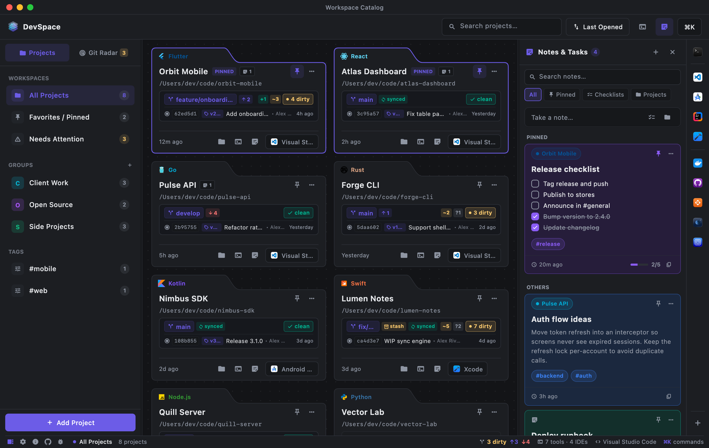
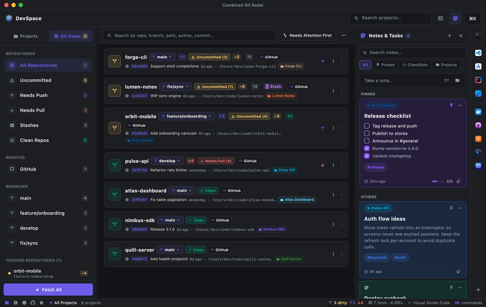
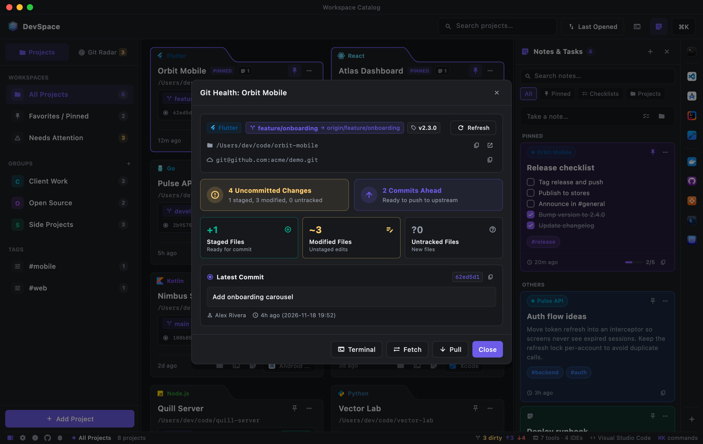
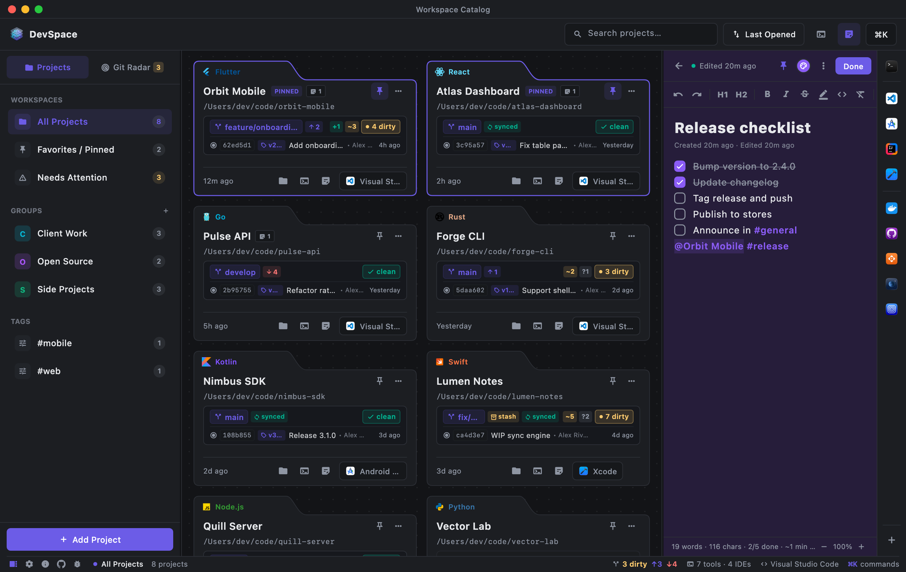
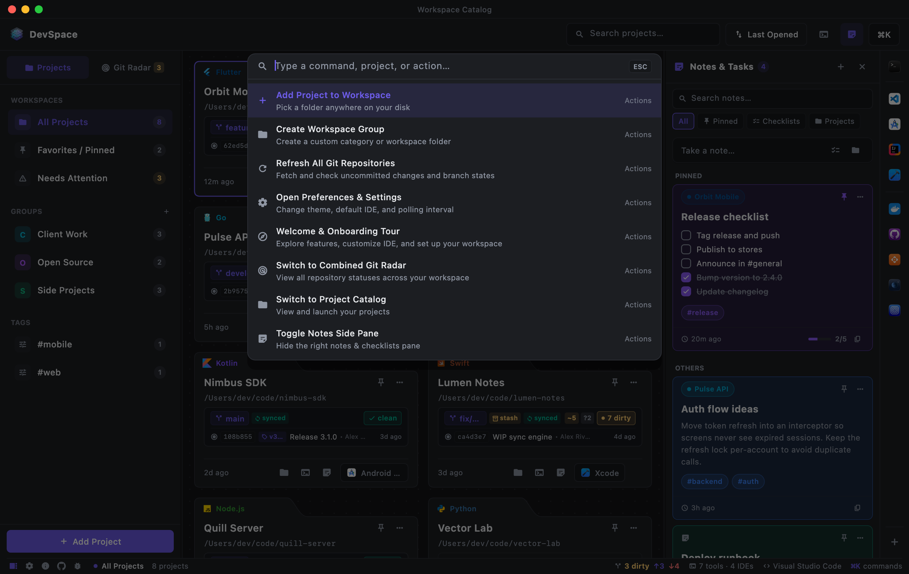
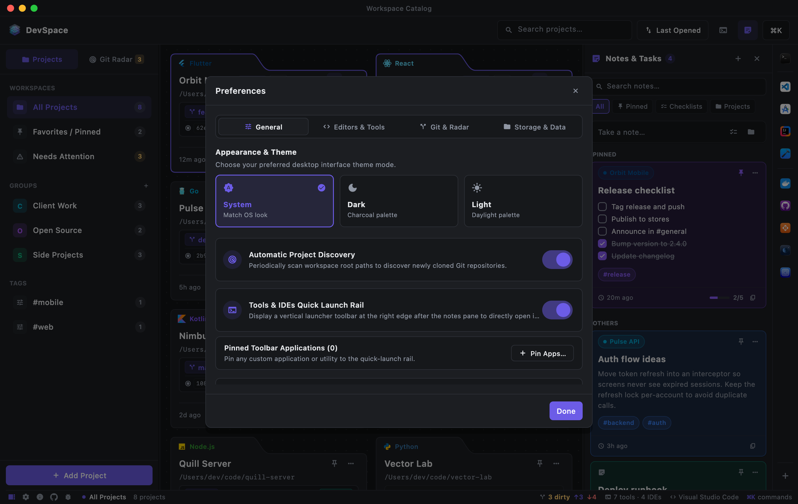

# User manual

This guide covers step-by-step instructions for everyday tasks in DevSpace.

## Managing Projects

### Adding a project
1. Click **+ Add Project** in the Catalog toolbar, press **⌘N** (macOS) / **Ctrl+N** (Windows/Linux), or select **Project ▸ Add Project** from the menu bar.
2. Select your project folder in the native file picker.
3. DevSpace detects the project type, discovers installed IDEs, and configures Git integration.
4. Customize the project display name, choose an icon or color tag, assign it to a Workspace, and pick your preferred default editor.
5. Click **Save Project**.

### Drag & Drop to Add Projects
- **Instant Folder Drop**: Drag any folder from Finder (macOS) or File Explorer (Windows/Linux) into the DevSpace window. DevSpace immediately registers the folder, detects its tech stack, scans for Git branches and changes, and displays a toast confirmation.
- **Target Specific Groups**: Drag a folder directly over a specific Workspace Group in the sidebar to add the project straight to that group.
- **Batch Import**: Select multiple project directories in your file manager and drop them together to import them in bulk.

### Editing or deleting a project
- Right-click any project card and choose **Edit Project** to change its name, default editor, group, or custom build scripts.
- Choose **Remove Project** from the context menu to unregister the project from DevSpace. This **only removes the project from DevSpace configuration**; your files on disk are completely untouched.

### Pinning favorites
- Hover over any project card and click the **Pin** icon (or toggle it in the project edit dialog).
- Pinned projects remain anchored at the top of the catalog for instant access.

---

## Launching Editors & Workspaces

### Opening in an editor
- Click the primary **Open in [Editor]** button on the project card to launch your default editor.
- Click the dropdown arrow next to the button to choose an alternate editor (e.g., VS Code, Cursor, Android Studio, Xcode, Zed, terminal editor).

### Handling Monorepos & Multi-Project Repositories
- If multiple registered projects belong to the same Git repository, or if you are viewing a repository in Git Radar:
  - Single-project repos open directly in your chosen editor.
  - Multi-project repos provide an **Open** submenu allowing you to choose whether to launch a specific subproject or the **Repo Root** in your default editor.

### Revealing in File Manager & Terminal
- Right-click a project and choose **Show in Finder** (macOS) or **Show in Explorer** (Windows) to jump to its directory.
- Choose **Open Terminal** to spawn your preferred terminal emulator directly inside the project root.

---

## Working with Git Radar

### Overview & Filtering
- Press **⌘2** or click **Git Radar** in the top navigation strip to view all monitored repositories.
- Filter repositories using the sidebar:
  - **All Repositories**: Complete overview.
  - **Uncommitted Changes (`dirty`)**: Repositories containing modified, added, or untracked files.
  - **Needs Push (`ahead`)**: Repositories with local commits ready to push.
  - **Needs Pull (`behind`)**: Repositories behind their upstream tracking branch.
  - **Clean**: Repositories with no pending sync or local changes.
  - **Stashes**: Repositories holding saved stashes.

### Using the Single-Row Header
- **Search**: Type in the search box to filter repositories instantly by name, branch, path, or author.
- **Sort**: Click the sort selector to reorder repositories by *Needs Attention First*, *Repository Name*, *Path*, *Unpushed*, or *Uncommitted*.
- **Dismiss Filters**: Click the `✕` on any active filter chip to restore the full view.
- **Batch Actions**: Use `Fetch All`, `Pull Clean`, or `Push All` on wider screens, or access them from the `···` overflow menu on compact displays.

### Inspecting Diffs in the Sidepane
1. Click any repository card in Git Radar. The interactive Git sidepane slides open on the right.
2. Clicking the card again retains the sidepane without closing it. Close it anytime via the **✕** button or **Esc**.
3. Under **Changed Files**, click any file to view its syntax-highlighted diff.
4. Toggle between unified and split diff views.
5. Click **Stage** or **Unstage** next to any file to stage individual changes.
6. Click **Discard** to revert modifications or delete untracked scratch files.

### Committing & Switching Branches
- **Commit**: Enter a commit message in the sidepane commit box and click **Commit Changes** (or press `⌘Enter`).
- **Branch Switching**: Click the active branch chip at the top of the sidepane to select a local or remote branch, or create a new branch.

---

## Quick Notes & Checklists

### Taking notes
1. Press **⌘3** to switch to the **Notes** tab, or press **⌘Shift+N** to create a new note immediately.
2. Enter your markdown notes, code snippets, or meeting action items.
3. Optionally link the note to a specific project.

### Interactive checklists
- Type `[]` followed by a space anywhere in a note. DevSpace automatically renders an interactive checklist box.
- Check and uncheck items; the state is automatically persisted in your local configuration.

---

## Command Palette (`⌘K` / `Ctrl+K`)

- Press **⌘K** (macOS) or **Ctrl+K** (Windows/Linux) from any screen.
- Type keywords to search across:
  - Project names and sub-paths
  - Git Radar actions (`Fetch All`, `Push Ahead`, `Rescan`)
  - Navigation tabs (**Projects**, **Git Radar**, **Notes**, **Tools**)
  - App settings and preferences
- Press **↵ (Enter)** to immediately execute the highlighted entry.

---

## Settings & Customization

Press **⌘,** (or select **DevSpace ▸ Settings**) to configure:
- **General**: Theme mode (System, Dark, Light), Open at Login (launch at system startup), automatic repository discovery, and tools quick-launch rail.
- **Editors**: Configure custom IDE executable paths and command-line arguments.
- **Git Radar**: Configure background auto-refresh polling intervals (e.g., 1 min, 5 min, 15 min, or manual only).
- **Terminal**: Choose your preferred terminal application (Terminal, iTerm2, Warp, Alacritty, Kitty, WezTerm, PowerShell, Windows Terminal).
- **Storage & Data**: View data storage location (`~/.devspace`), inspect log files, or reset application preferences.

